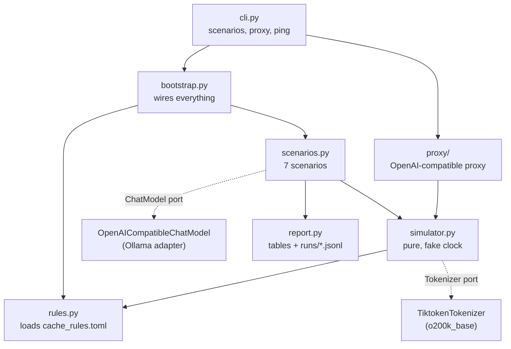
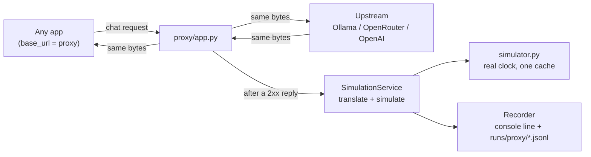

# Prompt Cache Meter: Design

## Purpose

The project answers one question: for a given conversation pattern, how much of the prompt would OpenAI serve from cache, and what would it bill?

Each request runs two ways, and the results are shown side by side:

| View | Where the numbers come from | What it shows |
| --- | --- | --- |
| Simulated OpenAI bill | Our simulator, applying OpenAI's caching rules to tiktoken (`o200k_base`) token counts | Input, cached, written and 1x tokens, hit rate, cost in USD |
| Real local run | Ollama through its OpenAI-compatible endpoint | Prompt tokens (Ollama's tokenizer), cached tokens, latency |

The simulator is the main subject. Ollama shows that prefix caching really saves work (warm latency drops from about 14 s to 3 s). It does not bill, though, and its tokenizer counts differently.

## Architecture

The design is ports and adapters. The core logic (simulator, scenarios, proxy service) depends only on small interfaces: `ChatModel` (send a chat, get a reply), `Tokenizer` (text to token ids), `Clock` (current time) and, in the proxy, `Recorder` (store one proxied call). The real implementations (the OpenAI SDK pointed at Ollama or OpenRouter, tiktoken, the system clock, the console and JSONL recorder) are adapters. `bootstrap.py` is the only place that wires concrete classes together.



| Component | Job | Talks to the outside world? |
| --- | --- | --- |
| `config.py` | Provider settings (Ollama, OpenRouter) and `OLLAMA_CONTEXT_LENGTH` from `.env` | Reads `.env` |
| `ports.py`, `llm/ports.py` | The `Clock`, `ChatModel` and `Tokenizer` protocols | No |
| `cache_rules.toml` | Every number: minimums, TTLs, multipliers, prices | No (data) |
| `rules.py` | Loads and validates the TOML into frozen Pydantic models | Reads one file |
| `simulator.py` | Decides cached / written / 1x tokens and the cost of one request | No |
| `scenarios.py` | Builds request sequences, advances the clock, collects rows | Through `ChatModel` only |
| `report.py` | Prints per-request and summary tables, writes JSONL logs | Console, `runs/` |
| `llm/` | Chat models, the OpenAI-compatible adapter (Ollama, OpenRouter), the tiktoken adapter, typed errors | Yes (network, tokenizer files) |
| `proxy/` | OpenAI-compatible proxy that simulates real traffic (see below) | Yes (HTTP in and out) |
| `bootstrap.py`, `cli.py` | Wiring and the `scenarios`, `proxy` and `ping` commands with their flags | Starts things |

Why this shape:

- The simulator has no I/O, so unit tests run in milliseconds with a fake tokenizer and no network.
- `--dry-run` simply leaves out the `ChatModel`, so the same scenario code runs either way.
- All the rules live in config, so correcting a number never touches code.

## How one request flows

For every request a scenario sends, `Session.send` does the following:

1. **Count.** Render the request into tokens: tools and schema first, then each message (overhead tokens + role + content), then reply-priming tokens. Remember where each message ends; those offsets are the possible cache boundaries.
2. **Warn.** If the token count is close to `OLLAMA_CONTEXT_LENGTH`, record a warning, because Ollama truncates silently.
3. **Call Ollama** (skipped in dry run). Record prompt tokens, cached tokens and latency, and warn if Ollama hit its context limit.
4. **Simulate.** The simulator:
    1. picks the cache namespace `(prompt_cache_key, model)` and drops expired entries;
    2. asks the generation's **policy** which prefix is a cache read and which boundaries to write;
    3. splits the prompt into read, written (per TTL) and 1x tokens;
    4. stores the new entries and refreshes the TTLs of entries that were read;
    5. prices it: `1x x input + cached x read rate + written x write rate + output x output price`.
5. **Record** a row: the bill, the Ollama observation, any warnings.

Time only moves when a scenario calls `clock.advance(...)`, so a "1 hour gap" costs nothing to run.

## The proxy

The proxy reuses the same simulator for real traffic from any app. It is a local Starlette server that speaks the OpenAI Chat Completions API and sits between the app and one upstream provider.



| Part | Job |
| --- | --- |
| `proxy/upstream.py` | Forwards a request to the provider, plain or streamed. The only proxy code that touches the network. |
| `proxy/translate.py` | Turns an OpenAI chat request into a `SimRequest`: roles (including developer and tool), content parts, tool calls, and prefix settings such as tools and `response_format`. |
| `proxy/replies.py` | Reads the reply text and usage from a response or an SSE stream without changing the bytes. |
| `proxy/service.py` | Translates, simulates and builds the record. Never raises; any problem becomes a warning. |
| `proxy/recorder.py` | Implements the `Recorder` port: prints one line and appends JSONL. Never logs message content or headers. |

Key choices:

- **Transparent.** The app gets back exactly what the upstream sent. A simulator problem can only add a warning to the log; it can never break a call.
- **Simulate after the reply.** Only successful (2xx) calls are simulated, because OpenAI does not bill failed calls and they should not warm the cache. The cost is that two overlapping requests may be simulated in completion order rather than arrival order.
- **One cache for the proxy's lifetime.** It runs on a real clock, so TTLs expire naturally. It lives in memory, so a restart is a cold start.
- **No locking needed.** Simulation runs synchronously on the event loop, so two requests can never update the cache at the same time.
- **Everything else passes through.** Requests to any other path (`/v1/models`, embeddings, and so on) are forwarded unchanged and not simulated, so apps that probe the API before chatting keep working.
- **Chat Completions only.** OpenAI offers explicit breakpoints and the 12h TTL only on the Responses API, so proxied traffic uses implicit caching.

## The caching rules

There are two generations, each implemented as a separate policy class and chosen in config.

| | Legacy (`FixedIntervalPolicy`) | New, GPT-5.6+ (`MessageBoundaryPolicy`) |
| --- | --- | --- |
| Where a hit can end | Any point, rounded down to a multiple of 128 | Only at a message boundary or explicit breakpoint |
| Read boundaries | Longest shared prefix | End of system block, latest user message, up to 20 earlier message ends, explicit breakpoints |
| Write cost | Free | 1.25x (30m) or 2.5x (12h), replacing the 1x rate |
| TTL options | `in_memory` (~10 min idle) or `24h` | `30m` (refreshed on read) or `12h` (not refreshed) |
| Explicit breakpoints | Not supported | Up to 4 writes per request; explicit mode with none caches nothing |

Rules shared by both:

- A hit needs an **identical prefix from token 0**. Changing the model, tools or response schema means a full miss.
- Prompts under **1,024 tokens** are never cached.
- Cached reads cost **0.1x** input (0.05x on gpt-6.1 models).
- Each `prompt_cache_key` gets its own namespace, so tenants never share a cache.

A worked example of the new rules. The first request sends a 1,355-token system prompt plus a question. On a miss, everything up to the end of the user message is written at 1.25x. A second request with a different question reads the system prompt (cached), writes the new question (written), and pays 1x only for the 3 reply-priming tokens.

## Scenarios and what they show

| Scenario | What it does | Lesson |
| --- | --- | --- |
| `cold-warm-broken` | Same prompt twice, then with a timestamp at the top | One changed early token throws away the whole cache |
| `question-wording` | "What's" vs "What is" after the same system prompt | Only the shared system prompt is reused |
| `name-placement` | User name at the start vs end of the system prompt | Legacy saves the part before the name; the new rules miss both, so put per-user text in its own message |
| `long-chat` | 60 turns: sliding window, summarise at budget, summarise after idle gap | Sliding windows break the prefix every turn; summarising once keeps a stable prefix (about 3x cheaper) |
| `rag-ttl` | System + 2 documents with breakpoints, questions 1 hour apart | With gaps longer than 30 min, 12h TTL pays for itself |
| `tenants` | Two keys, identical prompts | No cross-tenant reuse |
| `short-prompt` | Prompt under 1,024 tokens | Never cached |

Each scenario variant starts with an empty simulated cache. Ollama's real cache is not reset between scenarios, so it can show hits the simulator does not.

## Assumptions and limits

Confirmed from OpenAI's docs (checked 2026-09-28): the 1,024 minimum, 128 rounding, 4 write slots, the write and read multipliers, TTL refresh behaviour, and the 30m to 12h upgrade charge.

Assumptions (all adjustable in `cache_rules.toml` or noted in the README):

- `in_memory` lasts 10 minutes idle; the docs say 5 to 10 minutes, up to 1 hour.
- The legacy breakpoint interval is 128 tokens; the docs say it is model dependent.
- Chat overhead is 3 tokens per message plus 3, from the OpenAI cookbook.
- Tools and schema are rendered before the messages.
- A per-key namespace models tenant isolation. In reality caches are per organisation, and the key only steers routing.

Not modelled: OpenAI's hidden system tokens, overflow routing above about 15 requests per minute, regional boundaries, and the API surface (explicit breakpoints and 12h TTL are Responses API features).

## Running and testing

```sh
uv run prompt-cache-meter scenarios --dry-run                      # simulator only, new rules
uv run prompt-cache-meter scenarios --dry-run --generation legacy  # earlier-model rules
uv run prompt-cache-meter scenarios cold-warm-broken               # also calls Ollama
uv run prompt-cache-meter proxy                                    # simulate a real app's traffic
uv run prompt-cache-meter ping --provider openrouter               # check a provider is reachable
uv run pytest                                                   # unit tests, no network
uv run pytest --integration                                     # also call a real Ollama
```

The unit tests cover each rule on its own (hits, misses, rounding, TTL expiry and refresh, write slots, the docs' $0.01515 worked example). Each scenario also gets a smoke test with a fake `ChatModel`. The proxy is tested end to end with `httpx.MockTransport` standing in for the upstream, covering plain and streamed replies, passthrough and upstream failures. Tests that call a real provider are marked `integration` and skipped unless pytest gets `--integration`.
